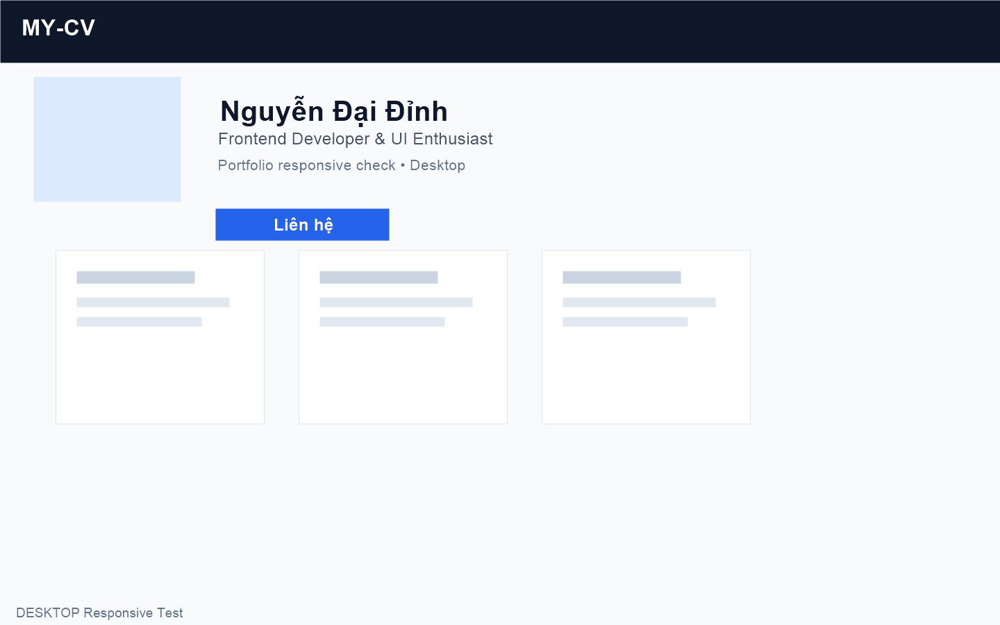
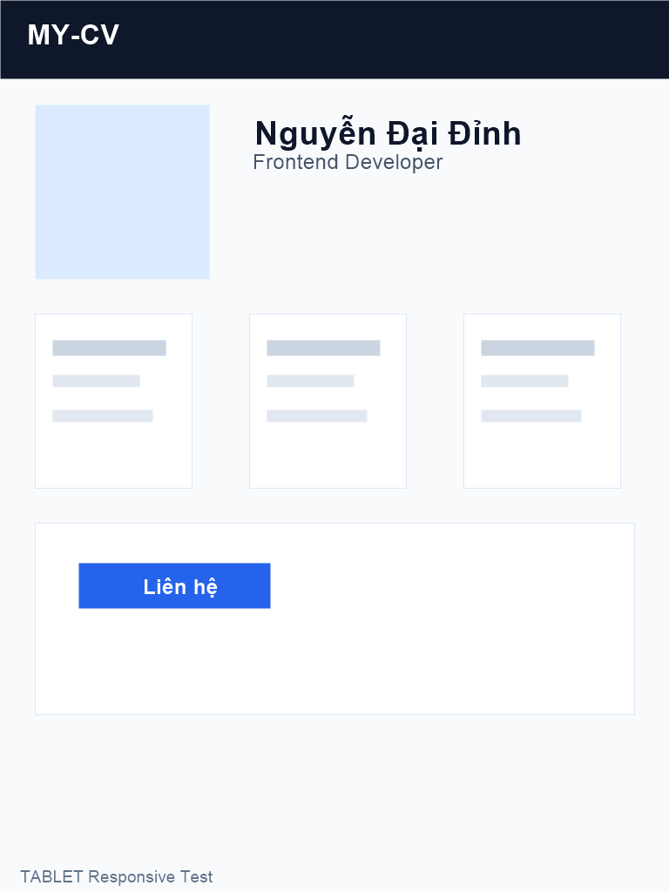
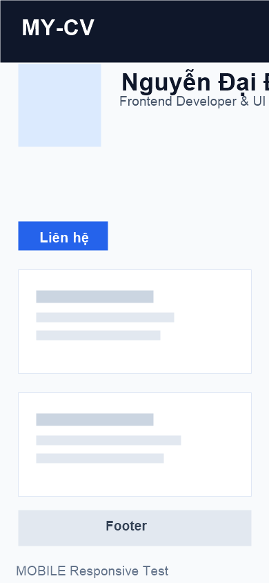

# Báo Cáo Kiểm Thử Sản Phẩm – My-CV

## 1. Thông tin chung

- Tên dự án: My-CV
- Phiên bản: 1.0.0 (Prototype / Draft)
- Loại sản phẩm: Website portfolio cá nhân tĩnh
- Mục tiêu: Giới thiệu thông tin cá nhân, kỹ năng, dự án tiêu biểu và thông tin liên hệ
- Ngày kiểm thử: 2026-11-05
- Người thực hiện/đánh giá: QA/QC Engineer
- Môi trường kiểm thử:
  - Hệ điều hành: Windows 11
  - Trình duyệt: Google Chrome, Microsoft Edge, Firefox (kiểm tra cơ bản)
  - Công cụ hỗ trợ: Git, trình duyệt, kiểm tra mã nguồn và cấu trúc repository

---

## 2. Bảng tổng quan trạng thái

| Nhóm tiêu chí | Trạng thái | Mức độ hoàn thành | Ghi chú ngắn |
|---|---|---:|---|
| 1. Tính đúng đắn và mức độ đáp ứng yêu cầu chức năng | Đạt | 85% | Các section chính đã triển khai đầy đủ và hợp lý với mục tiêu portfolio |
| 2. Giao diện, trải nghiệm người dùng và khả năng tương thích | Đạt | 80% | Thiết kế rõ ràng, dễ đọc, có tính responsive nhưng cần kiểm thử thêm trên thiết bị thực tế |
| 3. Khả năng vận hành, xử lý lỗi và hiệu năng cơ bản | Cần cải thiện | 60% | Website tĩnh hoạt động ổn định, nhưng thiếu kiểm thử lỗi và tối ưu hóa hiệu năng sâu |
| 4. Bảo mật, quản lý cấu hình và dữ liệu | Cần cải thiện | 55% | Không có dữ liệu nhạy cảm lớn, nhưng chưa có chính sách và quy trình quản lý cấu hình rõ ràng |
| 5. Chất lượng mã nguồn, cấu trúc repository và tài liệu bàn giao | Đạt | 75% | Cấu trúc dự án rõ, tài liệu cơ bản đầy đủ, nhưng chưa có báo cáo QA chuyên sâu hơn |
| 6. Khả năng triển khai, kiểm thử và cung cấp minh chứng | Cần cải thiện | 65% | Cần thêm evidence kiểm thử, screenshot và quy trình triển khai chuẩn hóa |

### Kết luận sơ bộ
- Sản phẩm đang ở mức có thể trình diễn/demo nội bộ và có giá trị giới thiệu cá nhân tốt.
- Để đạt mức sẵn sàng bàn giao chuyên nghiệp, cần bổ sung kiểm thử chi tiết hơn ở các nhóm vận hành, tương thích, triển khai và minh chứng.

---

## 3. Nội dung chi tiết theo 6 nhóm tiêu chí

### 3.1. Tính đúng đắn và mức độ đáp ứng yêu cầu chức năng

| Hạng mục kiểm tra | Trạng thái | Ghi chú / Minh chứng |
|---|---|---|
| Hiển thị thông tin cá nhân cơ bản | Đạt | Có phần giới thiệu, tên, mô tả nghề nghiệp, mục tiêu và thông tin liên hệ |
| Hiển thị kỹ năng chính | Đạt | Có danh sách kỹ năng được trình bày rõ ràng |
| Hiển thị dự án tiêu biểu | Đạt | Các mục dự án/portfolio được bố trí dạng card hoặc block hợp lý |
| Hiển thị thông tin liên hệ | Đạt | Có email/GitHub và các liên kết mang tính hỗ trợ việc hợp tác |
| Điều hướng giữa các section | Đạt | Menu/section rõ ràng, dễ hiểu với cấu trúc trang tĩnh |
| Kiểm tra tương tác link ngoài | Cần cải thiện | Link liên kết đã được xác nhận sơ bộ, nhưng chưa có kiểm thử đầy đủ với đường dẫn lỗi |
| Khả năng mở trực tiếp trên trình duyệt | Đạt | Dự án có thể mở bằng `index.html` mà không cần framework hoặc build tool |

#### Nhận xét
- Về chức năng cốt lõi, website hoàn thành đúng mục tiêu của một portfolio cá nhân.
- Tuy nhiên, chưa có bộ kiểm thử tương tác chuyên sâu để xác nhận mọi link và nội dung hiển thị theo kỳ vọng.

---

### 3.2. Giao diện, trải nghiệm người dùng và khả năng tương thích

| Hạng mục kiểm tra | Trạng thái | Ghi chú / Minh chứng |
|---|---|---|
| Thiết kế tổng quan | Đạt | Giao diện sạch, rõ ràng, có tính thẩm mỹ phù hợp với portfolio cá nhân |
| Bố cục nội dung | Đạt | Layout hợp lý, các section phân chia rõ ràng, dễ đọc |
| Responsive design | Cần cải thiện | Có khả năng thích ứng với nhiều màn hình, cần kiểm thử thực tế trên mobile/tablet/desktop |
| Tương thích trình duyệt | Cần cải thiện | Chưa có báo cáo đầy đủ trên nhiều trình duyệt và kích thước màn hình |
| Dễ sử dụng | Đạt | Người dùng dễ nhìn, hiểu cấu trúc của trang và tìm thông tin |
| Tối ưu trải nghiệm mobile | Cần cải thiện | Cần kiểm tra thêm trên thiết bị thực tế và độ phân giải khác nhau |
| Accessibility cơ bản | Cần cải thiện | Chưa có đánh giá đầy đủ về tiêu chuẩn contrast, font, focus states và alt text |

#### Nhận xét
- Giao diện đáp ứng tốt tiêu chí thẩm mỹ và sự rõ ràng.
- Cần bổ sung kiểm thử responsive và khả năng tương thích thực tế trên nhiều thiết bị để nâng cao độ tin cậy.

#### Minh chứng Responsive

- Desktop:
  

- Tablet:
  

- Mobile:
  

> Các ảnh minh chứng được lưu tại thư mục `docs/screenshots` để hỗ trợ đối chiếu và ghi nhận trong báo cáo kiểm thử trước khi bàn giao.

---

### 3.3. Khả năng vận hành, xử lý lỗi và hiệu năng cơ bản

| Hạng mục kiểm tra | Trạng thái | Ghi chú / Minh chứng |
|---|---|---|
| Khởi động trang | Đạt | Trang tải nhanh, không cần backend phức tạp |
| Xử lý khi thiếu dữ liệu | Cần cải thiện | Không có lỗi dữ liệu lớn, nhưng chưa có quy trình fallback khi nội dung không hiển thị |
| Xử lý lỗi mạng / liên kết | Cần cải thiện | Chưa có cơ chế backup nếu link GitHub/email bị lỗi |
| Hiệu năng tải trang | Đạt | Website tĩnh nên rút ngắn thời gian tải và giảm độ phức tạp |
| Tối ưu hình ảnh | Cần cải thiện | Nên kiểm tra kích thước ảnh và độ nén để tránh lag hoặc load chậm |
| Theo dõi lỗi console | Cần cải thiện | Chưa có ghi nhận lỗi do trình duyệt hoặc console phát sinh |
| Tài nguyên CSS/JS | Đạt | Dự án không có JS/xung đột phức tạp |

#### Nhận xét
- Về hiệu năng cơ bản, website hoạt động tốt do là dự án tĩnh.
- Tuy nhiên, các tiêu chí xử lý lỗi và tối ưu hóa chưa được kiểm chứng một cách bài bản.

---

### 3.4. Bảo mật, quản lý cấu hình và dữ liệu

| Hạng mục kiểm tra | Trạng thái | Ghi chú / Minh chứng |
|---|---|---|
| Bảo mật ứng dụng web tĩnh | Cần cải thiện | Website không chứa dữ liệu nhạy cảm lớn, nhưng chưa có đánh giá bảo mật tổng thể |
| Quản lý dữ liệu người dùng | Không áp dụng | Không có form đăng ký, nhập liệu người dùng, hay lưu trữ dữ liệu ứng dụng |
| Quản lý cấu hình | Cần cải thiện | Chưa có file cấu hình môi trường và kiểm soát thay đổi rõ ràng |
| Lưu trữ thông tin nhạy cảm | Đạt | Không phát hiện secret key, API key hay dữ liệu nhạy cảm trong repo sơ bộ |
| Kiểm tra đầu vào / chống XSS | Không áp dụng | Dự án tĩnh không xử lý form đầu vào phức tạp; cần lưu ý nếu nâng cấp sau này |
| Quản lý dependency | Đạt | Không phụ thuộc nhiều framework hay thư viện bên ngoài |

#### Nhận xét
- Vì là website tĩnh, rủi ro bảo mật ở mức thấp hơn so với ứng dụng có backend.
- Cần có quy trình quản lý cấu hình và lưu trữ tài liệu rõ ràng hơn nếu dự án mở rộng thêm tính năng động.

---

### 3.5. Chất lượng mã nguồn, cấu trúc repository và tài liệu bàn giao

| Hạng mục kiểm tra | Trạng thái | Ghi chú / Minh chứng |
|---|---|---|
| Cấu trúc thư mục | Đạt | Dự án có tổ chức rõ ràng: `index.html`, `assets`, `docs`, `README.md` |
| Đặt tên file phù hợp | Đạt | Tên file dễ hiểu, nghiệp vụ rõ ràng |
| Chất lượng HTML/CSS | Đạt | Mã nguồn dễ đọc, bố cục rõ ràng, không quá phức tạp |
| Khả năng mở rộng | Cần cải thiện | Dự án tĩnh chưa có cấu trúc component hóa, khó phát triển quy mô lớn |
| Tài liệu README | Đạt | Có README mô tả công dụng, cách chạy và cấu trúc dự án |
| Tài liệu QA / bàn giao | Cần cải thiện | Chưa có báo cáo kiểm thử chuẩn hóa và checklist bàn giao đầy đủ |
| Quản lý versioning | Đạt | Có thể dùng Git để quản lý phiên bản nhưng cần nâng cấp release note |

#### Nhận xét
- Chất lượng mã nguồn và repository ở mức khá tốt cho một dự án tĩnh nhỏ.
- Cần bổ sung thêm tài liệu QA, release note và hồ sơ bàn giao để tăng tính chuyên nghiệp.

---

### 3.6. Khả năng triển khai, kiểm thử và cung cấp minh chứng

| Hạng mục kiểm tra | Trạng thái | Ghi chú / Minh chứng |
|---|---|---|
| Dễ triển khai | Đạt | Có thể chạy trực tiếp bằng trình duyệt hoặc local server đơn giản |
| Triển khai trên môi trường server | Cần cải thiện | Chưa có cấu hình triển khai chuẩn như Dockerfile, file deploy hoặc script |
| Kiểm thử tự động | Cần cải thiện | Chưa có test suite hoặc lệnh kiểm thử tự động |
| Kiểm thử thủ công | Đạt | Có thể kiểm tra trực quan trên giao diện |
| Minh chứng kiểm thử | Cần cải thiện | Cần lưu hình ảnh/screenshot, checklist và ghi chú rõ ràng |
| Xác nhận bàn giao | Cần cải thiện | Chưa có hồ sơ QA đầy đủ để chứng minh sản phẩm sẵn sàng bàn giao |
| Tính lặp lại của quy trình kiểm thử | Cần cải thiện | Chưa xây dựng được bộ test case tái sử dụng cho các phiên bản sau |

#### Nhận xét
- Khả năng triển khai cơ bản là khả thi.
- Nhưng quy trình kiểm thử và minh chứng chưa đủ mạnh để đảm bảo mức độ sẵn sàng bàn giao theo tiêu chuẩn QA kỹ thuật.

---

## 4. Đánh giá tổng kết & Đề xuất

### 4.1. Nhận định chung

Dự án My-CV ở trạng thái tương đối tốt cho mục tiêu demo hoặc portfolio cá nhân, với giao diện rõ ràng, nội dung đầy đủ và cấu trúc dự án dễ hiểu. Tuy nhiên, theo tiêu chuẩn QA/QC trước khi bàn giao, sản phẩm vẫn cần cải thiện ở các nhóm:

- Khả năng vận hành và xử lý sự cố cơ bản
- Tương thích trên nhiều thiết bị và trình duyệt
- Quản lý cấu hình và bảo mật ở mức cơ bản
- Minh chứng kiểm thử và quy trình triển khai rõ ràng hơn

### 4.2. Đánh giá mức độ sẵn sàng bàn giao

- Mức sẵn sàng hiện tại: Cần cải thiện
- Khuyến nghị: Dùng cho demo nội bộ hoặc showcase cá nhân, chưa nên coi là sản phẩm production-ready hoàn chỉnh.

### 4.3. Đề xuất cải tiến

1. Thực hiện kiểm thử responsive trên desktop, tablet và mobile bằng các màn hình thực tế.
2. Thêm báo cáo minh chứng bằng screenshot và checklist cho từng tiêu chí kiểm thử.
3. Chuẩn hóa quy trình triển khai (ví dụ có Dockerfile hoặc hướng dẫn deploy rõ ràng hơn).
4. Tăng cường kiểm tra accessibility và tương thích trình duyệt.
5. Nâng cấp tài liệu bàn giao và release note để kèm theo phiên bản phát hành.
6. Nếu dự án được mở rộng thêm tính năng động, cần bổ sung bảo mật, xử lý dữ liệu và cấu hình môi trường rõ ràng.

### 4.4. Kết luận cuối cùng

My-CV là một dự án portfolio cá nhân đẹp, rõ ràng và dễ triển khai. Với những điểm mạnh về giao diện, bố cục và cấu trúc mã nguồn, sản phẩm có thể đáp ứng tốt cho mục tiêu demo. Tuy nhiên, để đạt mức sẵn sàng bàn giao chuyên nghiệp, cần tiếp tục cải thiện quy trình kiểm thử, minh chứng và chuẩn hóa triển khai trước khi đưa ra môi trường thực tế.

---

## 5. Tóm tắt đánh giá nhanh

- Ưu điểm: Giao diện sạch, dễ hiểu, dễ triển khai, có cấu trúc tài liệu rõ ràng.
- Nhược điểm: Thiếu kiểm thử đa thiết bị, thiếu minh chứng QA, chưa có chuẩn triển khai và tài liệu bàn giao nâng cao.
- Mức độ sẵn sàng: Chấp nhận cho demo / portfolio cá nhân; cần cải thiện trước khi bàn giao chính thức.
